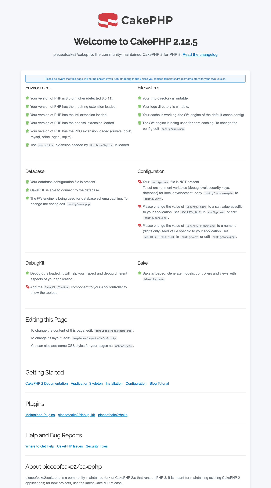
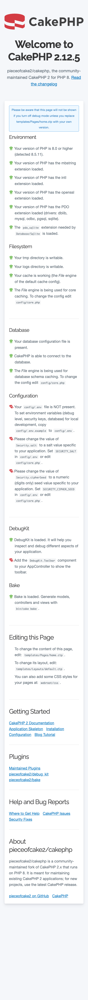
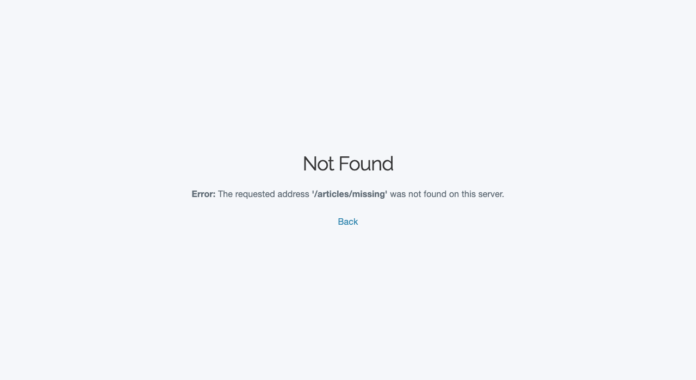
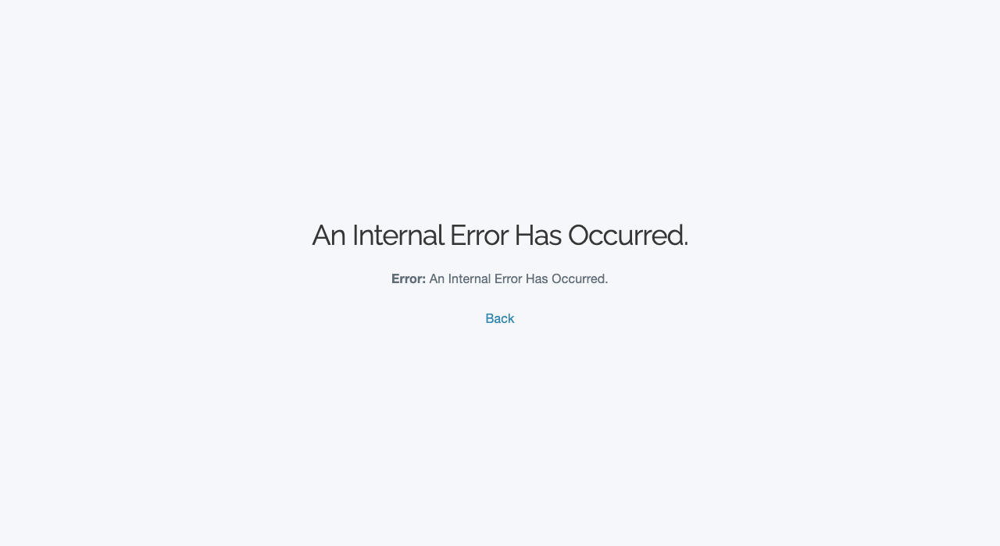
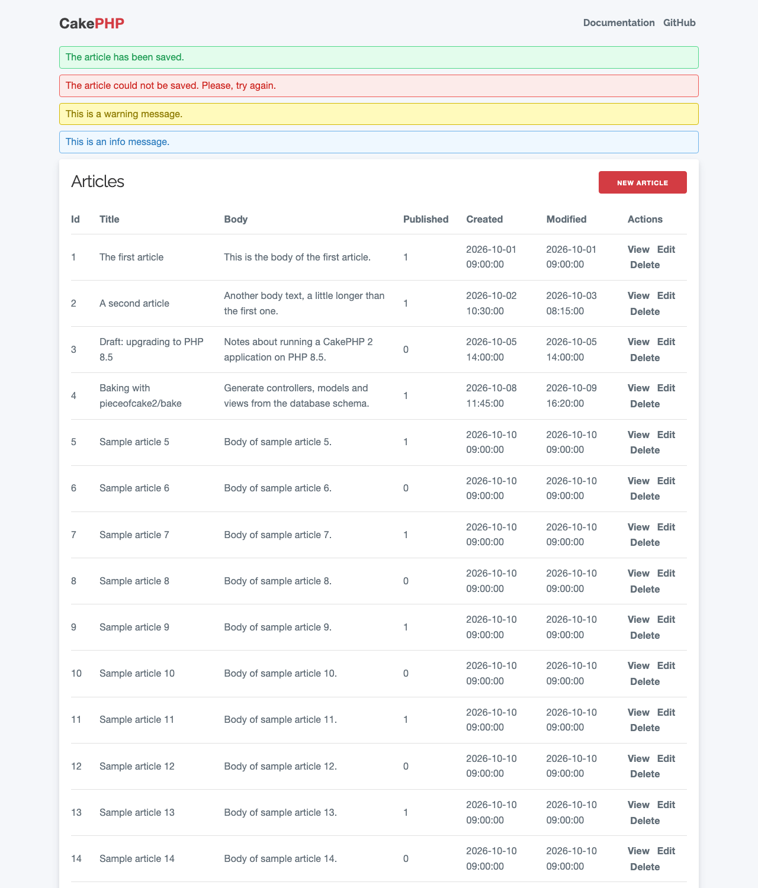

# アプリケーションスケルトンのドキュメント

pieceofcake2/app は、[pieceofcake2/cakephp](https://github.com/pieceofcake2/cakephp) で動作する
CakePHP 2 アプリケーションのためのアプリケーションスケルトンです。CakePHP 5 と互換性のあるディレクトリ構成
(`config/`、`src/`、`templates/`、`tests/`、`webroot/`) を使い、CakePHP とすべての依存パッケージを
Composer で読み込みます。

> [!WARNING]
> CakePHP 2.x は既存アプリケーションの保守のためのものです。新しいプロジェクトには、
> CakePHP の現在のメジャーバージョンを使ってください。

- [動作要件](#requirements)
- [インストール](#installation)
- [ディレクトリ構成](#directory-layout)
- [設定](#configuration)
- [環境変数 (.env)](#environment-variables-env)
- [アプリケーションの実行](#running-the-application)
- [ページとスタイル](#pages-and-styles)
- [開発](#development)

レガシーな `app/` 構成の既存アプリケーションをこの構成に移すには、
[モダン構成への移行](migrating-to-the-modern-layout.md) をご覧ください。

<a id="requirements"></a>

## 動作要件

- PHP 8.0、8.1、8.2、8.3、8.4 または 8.5
- [Composer](https://getcomposer.org/)
- データベース: MySQL 5.6 以上、PostgreSQL 9.4 以上、SQLite 3 または SQL Server 2022 以上
- PHP 拡張: `mbstring`、`intl`、`openssl` と、使用するデータベースの PDO ドライバー

詳しくは [pieceofcake2/cakephp の動作要件](https://github.com/pieceofcake2/cakephp#requirements--compatibility)
をご覧ください。

<a id="installation"></a>

## インストール

Composer の `create-project` コマンドで新しいアプリケーションを作成します。

```bash
composer create-project pieceofcake2/app my_app
```

これにより `my_app` ディレクトリが作成され、CakePHP (`pieceofcake2/cakephp`) が `vendor/` に
インストールされます。[Bake](https://pieceofcake2.github.io/bake/) プラグインと
[DebugKit](https://pieceofcake2.github.io/debug_kit/) プラグイン、そして開発ツール
(PHPUnit、[pieceofcake2/phpstan-cakephp2](https://pieceofcake2.github.io/phpstan-cakephp2/) を使った PHPStan、
CakePHP コーディング規約) は、開発用の依存パッケージとしてインストールされます。

続けて設定を仕上げます:

1. `config/database.php.default` を `config/database.php` にコピーしてデータベースの接続設定を入力するか、
   [環境変数](#environment-variables-env) で設定します。
2. `config/core.php` の `Security.salt` と `Security.cipherSeed` を変更するか、
   `SECURITY_SALT` と `SECURITY_CIPHER_SEED` を設定します。スケルトンには広く知られたサンプル値が
   入っており、実際のアプリケーションで使ってはいけません。
   [セキュリティ用のソルトの生成](#generating-the-security-salts) をご覧ください。
3. メールを送信する場合は、`config/email.php.default` を `config/email.php` にコピーして
   トランスポートを設定します。
4. Web サーバーが `tmp/` と `logs/` に書き込めることを確認します。

<a id="version-control"></a>

### バージョン管理

スケルトンの `.gitignore` ファイルはアプリケーション用のものなので、`create-project` の直後に
`git init` を実行できます。無視されるのは次のものです:

- `vendor/` と、Composer が `plugins/` にインストールするプラグイン (`plugins/Bake/` と
  `plugins/DebugKit/`)。Composer でさらにプラグインをインストールした場合は、それらを `.gitignore` に
  追加してください。`plugins/` にあるアプリケーション独自のプラグインはコミットされます。
- `tmp/` と `logs/` の中身。ディレクトリを残すための `empty` ファイルはコミットされます。
- 環境ごとの設定や認証情報を含む `config/database.php`、`config/email.php`、`config/.env` と `.env`。
- `phpunit.xml` (`phpunit.xml.dist` のローカルコピー) と `.phpunit.result.cache`。

すべての環境で同じバージョンの依存パッケージがインストールされるように、`composer.lock` はコミットしてください。

<a id="development-plugins"></a>

### 開発用プラグイン

`config/bootstrap.php` は、[Bake](https://pieceofcake2.github.io/bake/) プラグインと
[DebugKit](https://pieceofcake2.github.io/debug_kit/) プラグインがインストールされていれば読み込みます:

```php
foreach (['Bake', 'DebugKit'] as $plugin) {
    try {
        CakePlugin::load($plugin);
    } catch (MissingPluginException) {
        // The plugin is not installed.
    }
}
```

これらは開発用の依存パッケージなので、`composer install --no-dev` でアプリケーションをインストールした場合は
読み込まれません。Bake は次のように実行します。

```bash
bin/cake bake
```

DebugKit のツールバーを表示するには、`AppController` に `DebugKit.Toolbar` コンポーネントを追加します
([DebugKit のドキュメント](https://pieceofcake2.github.io/debug_kit/) を参照)。開発用の依存パッケージが
なくてもアプリケーションが動作するように、プラグインが読み込まれている場合にだけ追加してください。

```php
class AppController extends Controller
{
    public function __construct($request = null, $response = null)
    {
        if (CakePlugin::loaded('DebugKit')) {
            $this->components[] = 'DebugKit.Toolbar';
        }
        parent::__construct($request, $response);
    }
}
```

ツールバーが表示されるのは、`debug` が 0 より大きい場合だけです。

その他のプラグインは、`config/bootstrap.php` で `CakePlugin::load()` (または `CakePlugin::loadAll()`)
を使って読み込みます。`CakePlugin::load()` はプラグインがインストールされていないと
`MissingPluginException` を投げるので、開発用の依存パッケージであるプラグインは上の例のように囲んでください。

<a id="directory-layout"></a>

## ディレクトリ構成

```
my_app/
├── bin/
│   └── cake            the console
├── config/             configuration (core.php, bootstrap.php, routes.php, database.php, ...)
├── logs/               log files
├── plugins/            plugins installed by Composer
├── resources/
│   └── locales/        translation files
├── src/                PHP code
│   ├── Console/        shells, tasks and bake templates
│   ├── Controller/
│   ├── Lib/
│   ├── Model/
│   └── View/           helpers
├── templates/          view templates, layouts, elements and email templates
├── tests/
│   ├── Fixture/
│   └── TestCase/
├── tmp/                cache, sessions and test files
├── vendor/             Composer packages, including CakePHP
└── webroot/            document root (index.php, test.php, css/, js/, img/)
```

`webroot/index.php`、`webroot/test.php` と `bin/cake` は `config/define.php` を読み込みます。
このファイルは、ルートディレクトリ (`ROOT`)、アプリケーションディレクトリ (`APP_DIR`、`src`)、
ドキュメントルート (`WWW_ROOT`) と Composer の vendor ディレクトリ (`VENDORS`) を設定します。
その他のディレクトリは CakePHP が自分で見つけます。`config/`、`tests/`、`tmp/`、`logs/`、`templates/` と
`resources/locales/` は、存在すれば使われます。

`app/` ディレクトリを使うレガシー構成 (`app/Config/`、`app/Controller/`、`app/View/`、...) も
サポートされていますが、スケルトンに含まれるのはモダン構成だけです。

<a id="configuration"></a>

## 設定

| ファイル | 内容 |
| --- | --- |
| `config/core.php` | デバッグレベル、エラーと例外の処理、キャッシュ、セッション、セキュリティ用のソルト。 |
| `config/bootstrap.php` | キャッシュの設定、プラグインの読み込み、ログ、その他のアプリケーションの初期設定。 |
| `config/routes.php` | URL のルーティング。 |
| `config/database.php` | データベース接続 (`default` と `test`)。`database.php.default` からコピーします。 |
| `config/email.php` | メールのトランスポートとプロファイル。`email.php.default` からコピーします。 |
| `config/acl.php`、`config/acl.ini.php` | `IniAcl` と `PhpAcl` の設定。 |
| `config/define.php` | モダン構成のパス定数。 |
| `config/Schema/` | DbAcl、i18n、セッションのテーブルのスキーマファイル。 |

<a id="environment-variables-env"></a>

## 環境変数 (.env)

デバッグレベル、セキュリティ用のソルト、データベースの認証情報などの設定は、環境変数から読み込めます。
ローカルでの開発では、サンプルファイルをコピーして編集します。

```bash
cp config/.env.example config/.env
# or, in the project root:
cp config/.env.example .env
```

`config/.env` とプロジェクトルートの `.env` は、`config/core.php` の先頭で
[josegonzalez/dotenv](https://github.com/josegonzalez/php-dotenv) を使って読み込まれます
(そのため、Web リクエスト、`bin/cake`、テストのすべてに適用されます)。どちらも Git では無視されます。
値は `env()`、`getenv()`、`$_ENV`、`$_SERVER` で参照できます。

これは CakePHP 3 以降 / 5 のアプリケーションスケルトンの `.env` サポート
([cakephp/app](https://github.com/cakephp/app) は `config/bootstrap.php` で josegonzalez/dotenv を使って
`config/.env` を読み込みます) に倣ったもので、CakePHP 2 向けにバックポートし、プロジェクトルートの `.env` も
読み込めるように拡張しています。

| 変数 | 設定 | デフォルト |
| --- | --- | --- |
| `DEBUG` | `debug` (`0`、`1`、`2`、`true` = 2、`false` = 0) | `2` |
| `SECURITY_SALT` | `Security.salt` | `config/core.php` の値 |
| `SECURITY_CIPHER_SEED` | `Security.cipherSeed` (1〜4294967295。レガシーな `'cipher'` クッキーでのみ使用) | `config/core.php` の値 |
| `COOKIE_KEY` | `Cookie.key`。`'aes'` タイプでの `CookieComponent` のキー (2.12.6 からコンポーネントが読み込みます) | `null` (`Security.salt` が使われます) |
| `DB_DATASOURCE`、`DB_HOST`、`DB_PORT`、`DB_USERNAME`、`DB_PASSWORD`、`DB_DATABASE` | `config/database.php` の `default` 接続 | `config/database.php` の値 |
| `DB_TEST_DATASOURCE`、`DB_TEST_HOST`、`DB_TEST_PORT`、`DB_TEST_USERNAME`、`DB_TEST_PASSWORD`、`DB_TEST_DATABASE` | `config/database.php` の `test` 接続 | `config/database.php` の値 |

- 優先順位: 実際の環境変数 (Web サーバー、シェル、コンテナ、CI) > `config/.env` > ルートの `.env`。
  `config/.env` が先に、ルートの `.env` が後に読み込まれます。すでに設定されている変数が上書きされることはありません。
- 設定されていない変数や空の変数ではデフォルトが使われるので、`.env` ファイルがなければアプリケーションは
  これまでとまったく同じように動作します (`DB_PASSWORD` / `DB_TEST_PASSWORD` は空でもかまいません)。
- `.env` ファイルの値は引用符で囲んでください (例: `DEBUG="0"`)。引用符で囲まない数値はパーサーによって
  正規化されます (`007` は `7` になり、cipher seed のような長い数字の列はオーバーフローします)。
- `.env` ファイルは開発用です。本番環境では、代わりに実際の環境変数を設定してください。
- データベースの変数は `config/database.php.default` が読み込みます。この機能が追加される前に
  `config/database.php` を作成した場合は、`__construct()` メソッドと `applyEnv()` メソッドをそこにコピーしてください。

<a id="generating-the-security-salts"></a>

### セキュリティ用のソルトの生成

`Security.salt` と `Security.cipherSeed` は、暗号論的に安全な乱数生成器で生成してください。
以下のコマンドは、Linux と macOS のどの POSIX シェルでも動作します (cipher seed はレガシーな `'cipher'`
クッキーのタイプでしか使いません。[cipherSeed と 'cipher' クッキータイプ](#cipherseed-and-the-cipher-cookie-type)
をご覧ください):

```bash
# SECURITY_SALT: 64 hexadecimal characters
php -r 'echo bin2hex(random_bytes(32)), PHP_EOL;'
openssl rand -hex 32                               # without PHP

# SECURITY_CIPHER_SEED: a number from 1 to 4294967295
php -r 'echo random_int(1, 4294967295), PHP_EOL;'
od -An -N4 -tu4 /dev/urandom | tr -dc 0-9; echo    # without PHP
```

`config/.env.example` をコピーした後で、両方を `config/.env` に追記するには次のようにします
(同じ変数が 2 回設定されている場合は、後の行が有効になります):

```bash
php -r 'printf("SECURITY_SALT=\"%s\"\nSECURITY_CIPHER_SEED=\"%d\"\n", bin2hex(random_bytes(32)), random_int(1, 4294967295));' >> config/.env
```

PHP を使わない場合は次のとおりです:

```bash
printf 'SECURITY_SALT="%s"\nSECURITY_CIPHER_SEED="%s"\n' "$(openssl rand -hex 32)" "$(od -An -N4 -tu4 /dev/urandom | tr -dc 0-9)" >> config/.env
```

- ソルトは 32 文字以上にしてください。ソルトは `CookieComponent` のデフォルトのキーで、`'aes'` クッキーの
  タイプはそれより短いキーを受け付けません。
- これより長い cipher seed は使わないでください。意味があるのは 1〜4294967295 だけです (後述)。
- 環境ごとに異なる値を使い、コミットしないでください。本番環境では、実際の環境変数を設定してください。
- 後から `Security.salt` を変更すると、ユーザーはログアウトされ、開いているフォームは無効になり、
  暗号化されたクッキーは読めなくなります。また、HMAC ソルトを明示せずに `Security::encrypt()` で暗号化した
  データと、`SimplePasswordHasher` でハッシュ化したパスワードも使えなくなります (bcrypt のハッシュは影響を
  受けません)。`Security.cipherSeed` を変更して使えなくなるのは、デフォルトの `'cipher'` タイプのクッキーなど、
  `Security::cipher()` で暗号化した値だけです。

詳しい内容と、値を安全に入れ替える方法については、クックブックの
[セキュリティ用のソルトの生成](https://pieceofcake2.github.io/docs/ja/development/configuration#security-salts)
をご覧ください。

<a id="cipherseed-and-the-cipher-cookie-type"></a>

#### cipherSeed と 'cipher' クッキータイプ

`Security.cipherSeed` を使うのは `Security::cipher()`、つまり `CookieComponent` の暗号化タイプ `'cipher'` だけです。
これはデフォルトのタイプで、安全ではありません。

- `Security::cipher()` は `mt_srand((int)(float)$seed)` を呼び出すので、意味があるのは 1〜4294967295 だけです。
  27 桁以上の値と、26 桁の値の約 95% は、シード `0` になります。本家の CakePHP 2 とこのスケルトンの以前の
  バージョンの `config/core.php` にある 29 桁のデフォルト値、ブログチュートリアルの例、そして以前のバージョンの
  `config/.env.example` にあったコマンドで生成した値も、これに当てはまります。現在の `config/core.php` の
  フォールバックは範囲内のサンプル値ですが、それでも置き換えてください。
- 範囲内のシードにしても `'cipher'` は安全になりません。シードは約 43 億通りしかなく、キーストリームは
  暗号用ではない Mersenne Twister の XOR なので、総当たりで破れます。
- シードを変更すると、既存の `'cipher'` クッキーは読めなくなります。

代わりに、32 バイト以上のランダムな専用のキーと `'aes'` タイプを使い、`Security.useOpenSsl` が `true` であることを
確認してください。スケルトンは `config/core.php` でこれを設定しています。設定しないと、`Security::encrypt()`/`decrypt()`
は PHP 8 には存在しない mcrypt を呼び出し、`'aes'` クッキーは失敗します
([OpenSSL を有効にする](https://pieceofcake2.github.io/docs/ja/appendices/migrating-from-cakephp-2-10#enable-openssl)
を参照)。

pieceofcake2/cakephp 2.12.6 からは、`Cookie.type` と `Cookie.key` を設定で指定できます。

**2.12.6 以降:** `config/core.php` がソルトの隣で両方をすでに設定しているので、コントローラーを変更する必要はありません:

```php
Configure::write('Cookie.type', 'aes');
Configure::write('Cookie.key', env('COOKIE_KEY') ?: null);
```

`CookieComponent` は、明示的な `'type'`/`'key'` の設定 (または `type()` と `$this->Cookie->key`) を最初に使い、
次に `Cookie.type`/`Cookie.key`、最後に `'cipher'` と `Security.salt` を使います。

**2.12.5 以前:** `CookieComponent` は `Cookie.type` と `Cookie.key` を読み込まないので、上の行は効果がありません。
スケルトンは `CookieComponent` を使っていません。クッキーを追加するときは、`src/Controller/AppController.php` で
タイプとキーを渡してください。

```php
public $components = [
    'Cookie' => ['type' => 'aes'],
];

public function beforeFilter()
{
    parent::beforeFilter();
    $key = Configure::read('Cookie.key');
    if ($key) {
        $this->Cookie->key = $key;
    }
}
```

キーは設定されている場合にだけ代入してください。`null` のキーはデフォルトのキーを置き換えてしまい、暗号化が失敗します。
このコードは 2.12.6 以降でもそのまま動作します。

`'aes'` タイプには 32 バイト以上のキーが必要です。`COOKIE_KEY` が設定されていないと、`Cookie.key` は `null` になり、
キーには `Security.salt` が使われます。ソルトが 32 バイトより短いと、暗号化されたクッキーの書き込みや読み込みで
`CakeException` が投げられます。

キーは `php -r 'echo bin2hex(random_bytes(32)), PHP_EOL;'` または `openssl rand -hex 32` で生成し、
`config/.env` の `COOKIE_KEY` に設定してください (本番環境では実際の環境変数として設定します)。
既存のアプリケーションを `'cipher'` から `'aes'` に切り替えると、既存のクッキーの値 (たとえば、ログイン状態を保持する
remember-me) は一度失われます。影響、アプリケーションに合った選択肢、移行の手順については、クックブックの
[cipherSeed と Cookie の 'cipher' タイプ](https://pieceofcake2.github.io/docs/ja/development/configuration#cipher-seed)
をご覧ください。

<a id="running-the-application"></a>

## アプリケーションの実行

開発時は、次のコマンドで PHP のビルトイン Web サーバーを起動します。

```bash
bin/cake server
```

そして `http://localhost:8765/` を開きます。別のポートを使うには `--port` (`-p`) を指定します。

本番環境では、Web サーバーのドキュメントルートを `webroot/` に向けてください。`config/`、`logs/`、`tmp/`、`vendor/`
と `.env` ファイルを含むプロジェクトディレクトリに向けてはいけません。`webroot/.htaccess` ファイルは、
`mod_rewrite` を使う Apache のためにリクエストを `index.php` に書き換えます。Apache と nginx の例については、クックブックの
[Web サーバーの設定](https://pieceofcake2.github.io/docs/ja/installation/url-rewriting.html)
をご覧ください。

<a id="pages-and-styles"></a>

## ページとスタイル

レイアウト、ホームページ、エラーページ、フラッシュメッセージは
[CakePHP 5 のアプリケーションスケルトン](https://github.com/cakephp/app) から移植したもので、
`webroot/css/` にあるそのスタイルシートを使います:

| ファイル | 説明 |
| --- | --- |
| `normalize.min.css` | [normalize.css](https://github.com/necolas/normalize.css) 8.0.1 |
| `milligram.min.css` | [Milligram](https://milligram.io) 1.4.1 |
| `fonts.css` | `webroot/font/` から配信する Raleway フォント (フォントサービスへのリクエストはありません) |
| `cake.css` | アプリケーションのスタイル: レイアウト、フラッシュメッセージ、フォーム、テーブル、ページネーター、エラーページ、デバッグ出力 |
| `home.css` | ホームページだけのスタイル |
| `cake.generic.css` | 以前のスケルトンのスタイルシート。テンプレートはもう読み込みませんが、そのクラスを使っているビュー (たとえば `legacy` bake テーマで bake したビュー) のために残してあり、コアのフォールバック用レイアウトが読み込みます |

テンプレート:

- `templates/Layouts/default.ctp`: 上部のナビゲーションバーとコンテンツのコンテナ。`debug` が 2 の間は、
  コンテンツの下に SQL ログが表示されます。
- `templates/Layouts/error.ctp`: 本番環境のエラーページ用の最小限のレイアウト。
- `templates/Layouts/flash.ctp`: `Controller::flash()` が描画するページ。
- `templates/Elements/Flash/`: `default`、`success`、`error`、`warning`、`info` のフラッシュメッセージ
  (`$this->Flash->success('Saved.')` など)。メッセージはエスケープされます。HTML を出力するには
  `['params' => ['escape' => false]]` を渡します。メッセージをクリックすると非表示になります。

[pieceofcake2/bake](https://pieceofcake2.github.io/bake/) で bake したビューも同じスタイルを使います。

<a id="home-page"></a>

### ホームページ

`templates/Pages/home.ctp` は、`debug` が有効な間 `/` に表示されます。このページはアプリケーションの環境をチェックします。
PHP のバージョンと拡張 (mbstring、intl、openssl、PDO と `default` データソースのドライバー)、`tmp/` と `logs/`
ディレクトリ、キャッシュ、データベース接続 (失敗した場合はエラーメッセージも)、`config/.env`、セキュリティ用のソルトと
cipher seed、そして DebugKit プラグインと Bake プラグインです。本番環境では `NotFoundException` を投げるので、
`debug` を無効にする前に独自のページに置き換えてください。



スマートフォンでの表示:



<a id="error-pages"></a>

### エラーページ

`debug` が 0 のとき、`templates/Errors/error400.ctp` と `error500.ctp` は `error` レイアウトで短いメッセージを
表示します。





デバッグモードでは、CakePHP の他のエラーページと同じように、デフォルトのレイアウトを使ってスタックトレースを表示します。

<a id="flash-messages"></a>

### フラッシュメッセージ



<a id="existing-applications"></a>

### 既存のアプリケーション

以前のバージョンのスケルトンから作成したアプリケーションは影響を受けません。テンプレートと `webroot/css/` は
アプリケーション自身のものだからです。新しい見た目を使うには、`templates/Layouts/`、`templates/Elements/Flash/`、
`templates/Errors/`、`webroot/css/`、`webroot/font/` と `webroot/img/cake.logo.svg` をアプリケーションに
コピーしてください。`cake.generic.css` 向けに bake したビューは、bake し直す (またはスタイルを直す) 必要があります。
[bake したビューと legacy テーマ](https://pieceofcake2.github.io/bake/#baked-views-and-the-legacy-theme)
をご覧ください。

<a id="development"></a>

## 開発

<a id="running-tests"></a>

### テストの実行

テストケースは `tests/TestCase/` に、フィクスチャは `tests/Fixture/` に置きます。`config/database.php`
(または `DB_TEST_*` 変数) で `test` 接続を設定してから、PHPUnit でテストを実行します。

```bash
vendor/bin/phpunit
```

テストシェルで 1 つのテストケースだけを実行することもできます:

```bash
bin/cake test app Controller/PostsController
```

`phpunit.xml.dist` には 2 つのテストスイートがあります:

| スイート | ディレクトリ | 実行方法 |
| --- | --- | --- |
| `App` | `tests/TestCase/` (`EndToEnd/` を除く) | `vendor/bin/phpunit` (デフォルトのスイート) |
| `EndToEnd` | `tests/TestCase/EndToEnd/` | `vendor/bin/phpunit --testsuite EndToEnd` |

`vendor/bin/phpunit --testsuite App,EndToEnd` は両方を実行します。`phpunit.xml.dist` の `defaultTestSuite="App"`
により、`vendor/bin/phpunit` は速く、ブラウザーなしで実行できます。Symfony アプリケーションのように
**`vendor/bin/phpunit` ですべてを実行するには、この属性を 1 つ削除してください**。

<a id="end-to-end-tests"></a>

#### End-to-End テスト

`tests/TestCase/EndToEnd/` は、[pieceofcake2/panther](https://pieceofcake2.github.io/panther/)
([Markdown](https://github.com/pieceofcake2/panther/blob/1.x/docs/README.md)) を使ったブラウザーの
End-to-End テストのためのディレクトリです。pieceofcake2/panther は Symfony Panther と同じ方法でテストを実行します。
アプリケーションを PHP のビルトイン Web サーバーで起動し、ヘッドレス Chrome で操作します。使い方は次のとおりです:

1. パッケージと、使っている Chrome に合った chromedriver をインストールします。

   ```bash
   composer require --dev pieceofcake2/panther dbrekelmans/bdi
   vendor/bin/bdi detect drivers
   ```

2. `phpunit.xml.dist` の `ServerExtension` のコメントを外します。この拡張は、実行全体を通して Web サーバーと
   ブラウザーを動かし続けます。End-to-End テストが実行されるまでは何も起動しません。
3. `tests/TestCase/EndToEnd/` に `PieceOfCake2\Panther\TestSuite\PantherTestCase` を継承したテストを書き、
   `vendor/bin/phpunit --testsuite EndToEnd` で実行します。

これらのテストは Panther の `PANTHER_*` 変数で設定します。`phpunit.xml.dist` は次の 2 つを設定しています:

- `PANTHER_APP_ENV=test`: Panther は Web サーバーに `APP_ENV=test` を渡し、`config/database.php.default` は
  フィクスチャのある `test` 接続を `default` として使います。この機能が追加される前に `config/database.php` を
  作成した場合は、コンストラクターの `APP_ENV` の行をそこにコピーしてください。
- `PANTHER_ERROR_SCREENSHOT_DIR=./tmp/error-screenshots`: 失敗したテストのスクリーンショット。

`PANTHER_NO_HEADLESS=1` (ブラウザーの動きを見るため) のようなマシンごとの値は、シェルか、`phpunit.xml.dist` を
コピーした `phpunit.xml` で設定してください。CI では、End-to-End テストを別のジョブで実行してください。変数、
テスト用データベース、GitHub Actions の例については panther のドキュメントをご覧ください。

<a id="code-standards"></a>

### コーディング規約

CakePHP のコーディング規約に沿っているかコードをチェックします。

```bash
vendor/bin/phpcs
```

<a id="static-analysis"></a>

### 静的解析

`src/` と `config/` に対して PHPStan (レベル 5) を実行します。

```bash
vendor/bin/phpstan analyse
```

設定は `phpstan.neon` にあり、
[pieceofcake2/phpstan-cakephp2](https://pieceofcake2.github.io/phpstan-cakephp2/) 拡張を使います。

<a id="origin"></a>

## 由来

このパッケージは、[cakephp/cakephp](https://github.com/cakephp/cakephp) (Packagist では `cakephp/cakephp`、
最後のアップストリームのバージョンは 2.10.24) の `app/` ディレクトリを元にしており、元々は CakePHP コミュニティ
(Cake Software Foundation, Inc.) によるものです。これを別のパッケージとして切り出し、モダンな PHP で動く CakePHP 2 のために
[pieceofcake2](https://github.com/pieceofcake2) が保守しています。元のコードからの変更点は
[コミット履歴](https://github.com/pieceofcake2/app/commits/2.x) をご覧ください。
